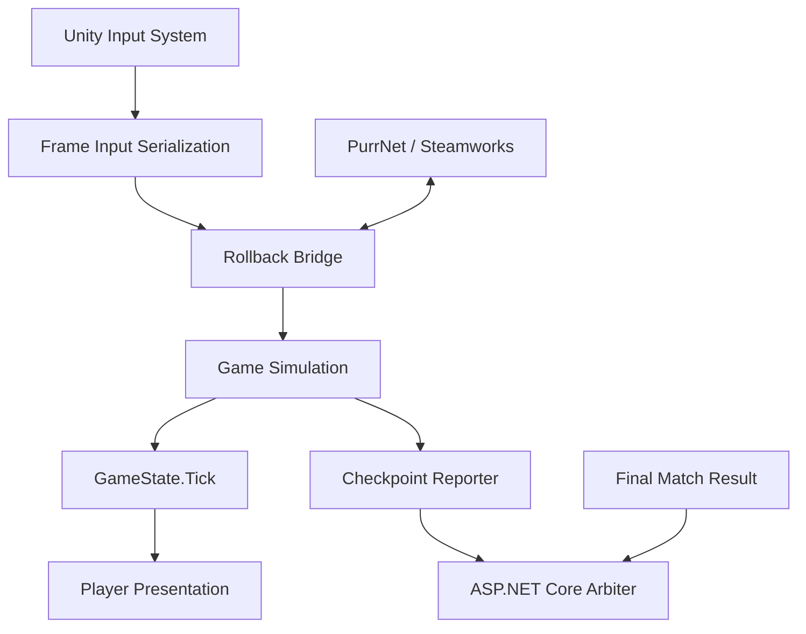

# Skill Club — Multiplayer & Rollback Netcode

### Technical Case Study | Unity 6 · C# · PurrNet · Steamworks · ASP.NET Core

A technical showcase of my engineering contributions to **Skill Club**, a 1v1 online fighting game developed in Unity as a collaborative university project.

My primary focus was building the multiplayer infrastructure, implementing a custom rollback netcode layer, developing an external match-consistency verification service, and creating tools to test and debug these systems.

**[View Skill Club on Steam](https://store.steampowered.com/app/4379690/Skill_Club/)**

---

## Video Demonstrations

Watch the custom multiplayer, rollback netcode, and backend debugging tools I developed for Skill Club.

### Featured Technical Demos

| Rollback Netcode Input Viewer | Arbiter Mismatch Detection |
|:---:|:---:|
|  |  |
| [Watch Rollback Input Viewer](https://youtu.be/H-txEZ7GAmU) | [Watch Arbiter Mismatch Detection](https://youtu.be/1A-h0easEIE) |

### Additional Demonstrations

- **[Network Latency & Rollback Testing](https://youtu.be/UjyOPIi2Rb4)** — Artificial network delay, ping monitoring, and rollback testing.
- **[Arbiter Backend Log Viewer](https://youtu.be/bNKAj5oAxHw)** — Match sessions, checkpoint responses, and verification diagnostics.
- **[In-Game Developer Tools Overview](https://youtu.be/QqpHVvJw9JQ)** — Centralized access to custom networking and backend debugging tools.

**[Explore All Developer Tools & Technical Demonstrations](docs/developer-tools.md)**

---

## My Role

**Multiplayer & Backend Programmer — Stavros Savvakis**

Areas of responsibility:

- Rollback netcode architecture and implementation
- Frame-based input serialization, prediction and resimulation
- PurrNet and Steamworks multiplayer integration
- Multiplayer session lifecycle and synchronization
- ASP.NET Core Arbiter backend and Unity integration
- Networking and rollback debugging tools
- Azure DevOps CI/CD and Steam build workflows

The game was co-developed with **Rafail-Angelos Savvakis**, whose work focused on the core gameplay and combat systems.

## System Architecture

The architecture separates input collection, network transport, rollback simulation, gameplay state updates, and visual presentation.

The Arbiter runs independently from the two game clients and compares submitted match data for consistency.

## 1. Custom Rollback Netcode

The rollback system was designed to reduce perceived input delay in online matches without requiring players to wait for every remote input.

Its main responsibilities include:

- Representing gameplay inputs as frame-indexed data.
- Recording local and remote input histories.
- Predicting unavailable remote inputs.
- Saving historical gameplay states.
- Detecting differences between predicted and received inputs.
- Restoring an earlier state and resimulating affected frames.

The `GameSimulation` component manages the simulation history and rollback logic, while `RollbackBridge` integrates the simulation with network input exchange.

A key architectural decision was keeping the simulation state separate from Unity's visual presentation.

[Read the Rollback Netcode Technical Deep Dive](docs/rollback-netcode.md)

## 2. Multiplayer Integration

The online flow uses **PurrNet**, **Steamworks**, and Steam networking transport.

My work included:

- Establishing multiplayer connections from Steam lobby information.
- Managing host/client connections and disconnections.
- Spawning player objects and assigning ownership.
- Synchronizing match preparation and shared simulation start frames.
- Exchanging frame-indexed player inputs.
- Running the simulation against synchronized network ticks.
- Handling multiplayer cleanup and scene transitions.

The implementation uses a small input delay alongside rollback prediction to balance responsiveness and the likelihood of remote inputs arriving in time.

## 3. Match Verification — Arbiter Backend

I developed a lightweight external verification service using **ASP.NET Core Minimal API**.

The backend exposes endpoints for:

- Creating match sessions.
- Receiving gameplay-state checkpoints.
- Receiving final match results.
- Comparing reports submitted by both players.

The Unity client generates **SHA-256 hashes** from selected simulation-state values and submits them to the Arbiter.

The service compares checkpoint hashes and final result data to identify disagreements between clients.

**Important distinction:** This is a match-consistency verification system, not a fully authoritative game server or comprehensive anti-cheat solution.

[Read the Arbiter Backend Technical Deep Dive](docs/arbiter-backend.md)

## 4. Developer & Debugging Tools

To support implementation and testing, I created several in-game tools:

**Rollback Input Viewer**
- Displays frame-by-frame inputs for both players.
- Distinguishes predicted inputs from corrected inputs.
- Supports multiple visualization modes.

**Network Diagnostics**
- Displays connection latency and rollback counts.
- Supports adding artificial delay to test rollback behavior.

**Arbiter Testing Tools**
- Displays verification-related logs inside the game.
- Allows controlled checkpoint and final-result mismatches for testing.

These tools helped make networking behavior observable during development.

## 5. CI/CD and Deployment

The project uses automated build and deployment workflows involving **Azure DevOps Pipelines** and **SteamPipe**.

I also implemented a Unity Editor build entry point for generating Windows builds from command-line pipeline execution.

The Arbiter backend was deployed separately to a VPS.

## Technical Considerations

- The simulation uses a fixed-point math layer to support deterministic-friendly gameplay calculations.
- State history is maintained within a limited rolling window.
- Checkpoints are taken from historical states to allow time for rollback corrections.
- Visual smoothing is handled separately from gameplay-state calculations.
- The Arbiter currently provides lightweight consistency checking rather than complete server authority.

## Technologies

**Languages:** C#, ASP.NET Core

**Game Engine:** Unity 6

**Networking:** PurrNet, Steamworks, Steam Transport

**Backend:** ASP.NET Core Minimal API, HTTP/JSON, SHA-256

**DevOps:** Azure DevOps, Azure Pipelines, SteamPipe

**Development Focus:** Rollback Netcode, Multiplayer Synchronization, State Management, Debugging, CI/CD

## About This Repository

This repository is a technical case study of my individual contributions to a collaborative game project.

It is not intended to be a complete public release of the Unity project or its proprietary source code.

Selected technical examples, architecture documentation, and demonstrations may be added separately.

---

**Developer:** Stavros Savvakis

**Project:** [Skill Club on Steam](https://store.steampowered.com/app/4379690/Skill_Club/)
